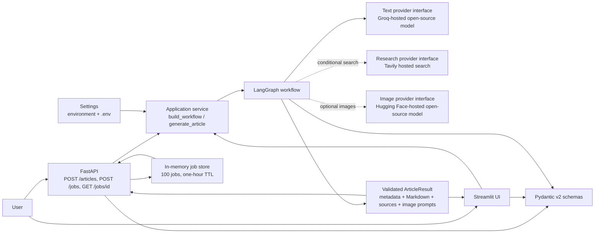
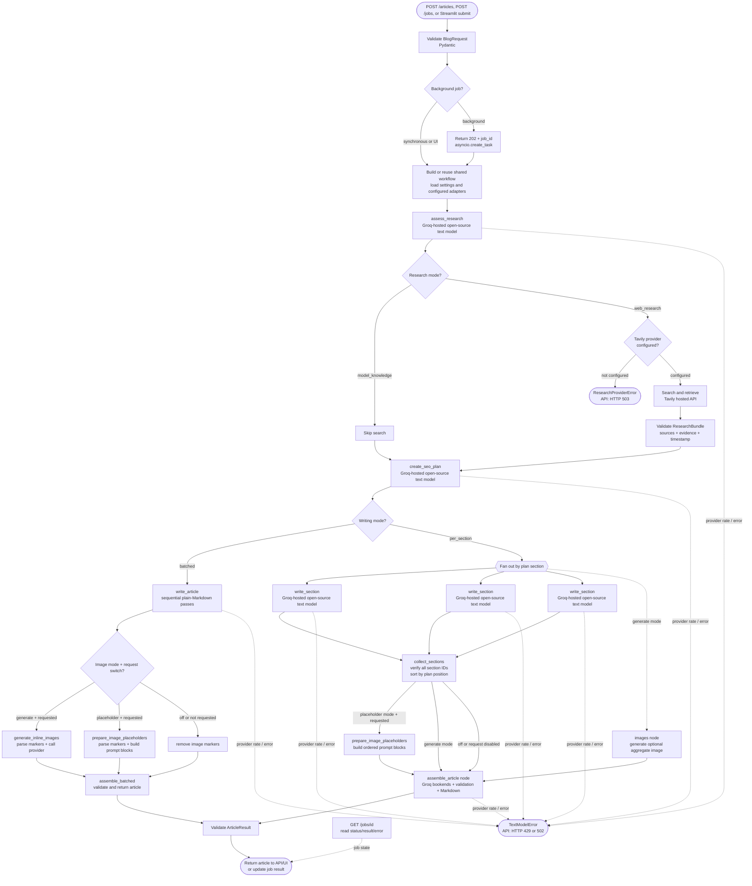

# SEO Blog Writing Assistant: Pipeline and Architecture

This document describes the implemented application: how a request enters the
system, how LangGraph routes it, where providers are called, how the article is
validated and assembled, and what the caller receives. The API and Streamlit
interface are separate entry points over the same application service and
workflow.

## Architecture at a glance



The dotted connections are conditional: Tavily is called only when the
workflow selects web research, and Hugging Face is called only in `generate`
image mode when the request sets `generate_images` to `true`. The default
`placeholder` mode creates copyable prompt blocks without constructing or
calling an image provider. The text provider is required for article
generation.

The configured text model and optional image model are open-source/open-weight
models accessed through hosted provider APIs (Groq for text and Hugging Face
for images), not models downloaded and run locally by this application. The
default placeholder mode does not call an image model. The intended setup uses
provider free-tier quotas where available; quotas, access, and model
availability are controlled by each provider and can change. Tavily is a
hosted web-search service, not a model.

## End-to-end workflow



`writing_mode=batched` writes the full article in sequential Markdown passes,
then routes image markers to placeholder construction, hosted generation, or
removal. `writing_mode=per_section` fans out section writers; the image node is
added and run concurrently only in `generate` mode. Placeholder mode collects
the structured section prompts in plan order and assembles them without an
image-provider object. Each section keeps a stable ID and position. Both modes
use the shared text adapter with bounded concurrency and transient retries.

## Pipeline stages

### 1. Request entry and validation

- The API exposes `POST /articles`; FastAPI parses and validates the JSON body
  as `BlogRequest`. Invalid input is rejected with HTTP 422 before generation.
- The Streamlit UI gathers the same request options, constructs the same
  `BlogRequest`, and displays validation errors in the page.
- Before submission, the UI requires a password-masked Groq API key in the
  sidebar. It replaces any server-configured text key for this request, and the
  workflow is built per submission rather than cached across users. The key is
  not written to project configuration; only use the UI on a deployment you
  trust because its server sends the key to Groq.
- `generate_article` is the shared application entry point. It invokes the
  compiled workflow with the request and validates the final output as an
  `ArticleResult`.
- Both entry points return or display the article result produced by the same
  workflow; UI and API do not maintain separate generation logic.

The request supports a topic, audience, tone, optional category override,
target country, target word count, SEO goals, whether freshness or citations
are required, and whether to generate an image. Pydantic bounds these fields
before the workflow uses them. Omitting `category` enables automatic detection;
the Streamlit UI exposes the same choice.

The existing first research-assessment call returns both `topic_category` and a
short `content_angle`, without adding a model call. The resolved category and
angle are carried in workflow state and the final `ArticleResult`.

| Category | Research policy | Outline/evidence focus |
| --- | --- | --- |
| `technology` | Recommended | Mechanisms, adoption, limitations, and sourced versions or benchmarks |
| `sports` | Required | Recent context, sourced stats, records, historical comparisons, and turning points |
| `food` | Optional | Origins, ingredients, technique, variations, nutrition and safety |
| `politics` | Required | Neutral history, institutions, timelines, sourced results, and fair perspectives |
| `business_finance` | Required | Market context, sourced figures, risks, and outlook; not financial advice |
| `health_science` | Recommended | Research evidence, benefits, risks, practical guidance; not medical advice |
| `travel_culture` | Optional | Culture, attractions, seasons, practical tips, etiquette, and safety |
| `entertainment` | Recommended | Works, sourced dates/ratings/awards, reception, and cultural impact |
| `history_education` | Optional | Timelines, people, causes, interpretations, and relevance |
| `general` | Optional | Broad reader-centered outline; do not invent statistics or sources |

### 2. Configuration and provider construction

`Settings` loads configuration from environment variables and the project
`.env` file. Provider adapters are constructed when the application builds
the workflow:

| Purpose | Current adapter | Configuration |
| --- | --- | --- |
| Text generation | LangChain `ChatGroq`; structured JSON Schema for research decisions/plans and per-section writing, plain Markdown for batched writing; the selected open-source/open-weight model runs through Groq hosted inference | `SEO_BLOG_TEXT_MODEL_PROVIDER=groq`, `SEO_BLOG_TEXT_MODEL_NAME`, and `SEO_BLOG_GROQ_API_KEY` (or an accepted key alias) |
| Web research | Tavily hosted search and retrieved Markdown content; this is a search service, not a model | `SEO_BLOG_SEARCH_PROVIDER=tavily`, `SEO_BLOG_SEARCH_API_KEY` |
| Image generation | Optional open-source/open-weight image model through Hugging Face Inference Providers with configurable automatic routing | `SEO_BLOG_IMAGE_MODE=generate`, `SEO_BLOG_IMAGE_PROVIDER=huggingface`, `SEO_BLOG_IMAGE_MODEL_NAME`, `SEO_BLOG_IMAGE_INFERENCE_PROVIDER`, `SEO_BLOG_IMAGE_NUM_INFERENCE_STEPS`, `SEO_BLOG_HUGGINGFACE_TOKEN` |

Important text and research controls:

| Setting | Default | Effect |
| --- | --- | --- |
| `SEO_BLOG_TEXT_MODEL_MAX_CONCURRENCY` | `2` | Max in-flight calls to the text provider for this process |
| `SEO_BLOG_TEXT_MODEL_MAX_ATTEMPTS` | `4` | Attempts for retryable text failures |
| `SEO_BLOG_TEXT_MODEL_MAX_COMPLETION_TOKENS` | `4096` | Completion cap per call; higher values allow longer sections but can use more TPM |
| `SEO_BLOG_TEXT_MODEL_REQUESTS_PER_SECOND` | unset | Optional LangChain request pacing |
| `SEO_BLOG_TEXT_MODEL_REASONING_EFFORT` | `low` | `low`, `medium`, `high`, or unset; sent only for `openai/gpt-oss*` models |
| `SEO_BLOG_WRITING_MODE` | `batched` | Sequential plain-Markdown passes, or `per_section` for structured concurrent sections |
| `SEO_BLOG_MAX_WORDS_PER_CALL` | `1500` | Planned word budget per batched writing pass |
| `SEO_BLOG_IMAGE_MODE` | `placeholder` | `placeholder` adds copyable prompt blocks, `generate` calls Hugging Face, `off` disables image markers |
| `SEO_BLOG_MAX_IMAGES` | `3` | Max prompts or generated images per article; `0` disables images |
| `SEO_BLOG_SEARCH_MAX_ATTEMPTS` | `3` | Attempts for retryable Tavily request failures |
| `SEO_BLOG_SEARCH_QUERIES_PER_ARTICLE` | `2` | Category-specific query cap, range 1–3 |
| `SEO_BLOG_IMAGE_INFERENCE_PROVIDER` | `auto` | Hugging Face Inference Provider selection |
| `SEO_BLOG_IMAGE_NUM_INFERENCE_STEPS` | `4` | Diffusion steps, configurable from 1 to 50; unset to use provider defaults |

Other related limits include `SEO_BLOG_TEXT_MODEL_TIMEOUT_SECONDS` (120),
`SEO_BLOG_SEARCH_TIMEOUT_SECONDS` (30), `SEO_BLOG_SEARCH_MAX_RESULTS` (5),
and `SEO_BLOG_IMAGE_TIMEOUT_SECONDS` (120). A warning is logged once per
configured Groq model that is not `openai/gpt-oss-20b` or
`openai/gpt-oss-120b`, since strict JSON Schema decoding is ignored for other
models by the Groq adapter. Confirm model availability and account quotas in
the Groq console.

This deployment uses hosted APIs rather than local inference. Free Hugging
Face accounts receive only about $0.10 of Inference Providers credit per
month, shared across providers. Images are capped at three per article by
default and remain off unless requested. Check provider terms, quotas, and
model availability; free access is not guaranteed by the application.
The default Groq completion cap is 4,096 tokens per call to reduce oversized
requests; it can be changed with `SEO_BLOG_TEXT_MODEL_MAX_COMPLETION_TOKENS`.
This output cap cannot prevent 429 responses when the account's
organization-level token or request quota is exhausted.

Research and image handling are optional capabilities; text generation is
required. The default placeholder mode does not need Hugging Face credentials.
Free accounts have about $0.10/month of Inference Providers credit shared
across providers, so image generation remains opt-in and capped at three by
default. Provider interfaces allow tests to use fakes rather than network
calls. Credentials are kept in secret settings and should not be logged or
committed.

### 3. Research decision and routing

The first graph node asks the text model for a validated `ResearchDecision`
using the topic and relevant request preferences. This is a decision about
whether general model knowledge is likely sufficient; it does not mean that
the topic has been searched or fact-checked.

- If freshness or citations are explicitly required, the workflow enforces
  the `web_research` route even if the model suggested `model_knowledge`.
- The caller's optional category overrides model detection. Otherwise the
  model's `topic_category` is used, falling back to `general` when omitted.
- Categories with `required` research (`sports`, `politics`, and
  `business_finance`) always select `web_research`. Without a configured
  provider they fail with category-specific setup guidance.
- Categories with `recommended` research (`technology`, `health_science`, and
  `entertainment`) select web research when a provider is configured; without
  one, they stay on model knowledge and return a warning that figures are
  unverified. Categories marked `optional` keep the model's choice.
- If web research is selected but no search provider is configured, the
  workflow reports a research-provider error instead of pretending research
  occurred.

The UI's `LLM-written · Web research assisted` label means retrieved web
sources were supplied as context after the search branch completed. The LLM
still writes every article and may also draw on existing model knowledge; this
label does not mean the prose came exclusively from websites. The
`LLM knowledge · No web search` label means no web-search branch was run.

### 4. Optional web search and evidence

On the research branch, the Tavily adapter builds category-aware queries from
the topic, profile hints, and (when present) target country. It runs up to
`SEO_BLOG_SEARCH_QUERIES_PER_ARTICLE` queries sequentially (default 2; range
1–3), merges results, de-duplicates by canonical source ID, and caps the merged
source list at `SEO_BLOG_SEARCH_MAX_RESULTS`. All attempted query strings are
recorded in `ResearchBundle.search_queries`. For fresh sports or politics
requests, Tavily uses `news` for the first query and `general` for follow-up
history/background searches.

The sports hints are `latest results stats` and `history records past seasons`;
politics uses `facts timeline` and `results analysis`; business/finance uses
`latest figures` and `analysis outlook`; health/science uses `research
evidence`; entertainment uses `reviews ratings`. Other profiles add no hints
and use one topic query. A failed first query remains fatal; a failed later
query adds a warning while preserving earlier evidence. The adapter sends
authenticated hosted search requests asking for Markdown content, validates
returned metadata and content, assigns stable source IDs, records a timestamp,
and returns a `ResearchBundle`.

The adapter prefers a query-relevant Tavily `content` extract when it is at
least 200 characters. Otherwise, it uses retrieved Markdown after trimming
leading boilerplate where a substantive line is available. Transient timeouts,
connection failures, HTTP 429, and server errors are retried up to
`SEO_BLOG_SEARCH_MAX_ATTEMPTS`; `Retry-After` is honored up to 60 seconds.
Invalid credentials, quota/plan errors, invalid response data, or no usable
evidence fail explicitly. The bundle preserves original source metadata and
evidence in workflow state; a completed bundle is never fabricated.

Before research is included in text-model prompts, the workflow compacts it to
profile-specific evidence limits: sports, politics, and business/finance use
six snippets of up to 600 characters; technology, health/science, and
entertainment use four of up to 600; other profiles use three of up to 500.
Sports and politics round-robin across sources. Other per-section prompts rank
evidence by keyword overlap. Prompt context excludes search queries, URLs, and
publishers; the full bundle and its source metadata remain in workflow state.

### 5. SEO plan

The planning node asks the text model for an `SEOPlan`, containing article
metadata, a primary and related keywords, search intent, introduction and
conclusion briefs and budgets, and an ordered list of section briefs. Each
planned section includes an ID, position, heading, purpose, key points,
subheadings, and word budget.

Pydantic validates the plan, including unique section IDs, contiguous
zero-based positions in outline order, and a total word budget close to the
requested target. The order returned in the section list is authoritative;
positions are normalized to that order. If budgets are far from the target,
they are proportionally rescaled when they can fit field bounds. If the model
returns a different target length, the plan is revalidated against the
requested length and its budgets are repaired where possible.

If research mode was selected, planning requires the completed research bundle.
Model-generated planning briefs are instructions for later writing, not
finished article paragraphs. The plan call receives only the selected profile
and content angle. It must choose fitting outline elements rather than pad the
outline; technical problem/limitations/solutions sections are not forced on
non-technical topics. Sports and politics plans include history/background and,
when research exists, a section based on key data.

### 6. Article writing modes

The default `batched` mode minimizes text-model calls. It greedily groups
contiguous planned sections into sequential passes up to
`SEO_BLOG_MAX_WORDS_PER_CALL`; the introduction is written in the first pass
and conclusion in the last. A 1,200-word article within the default 1,500-word
limit uses three normal text calls total: research decision, SEO plan, and one
plain-Markdown writing call. A 3,000-word article typically uses two writing
passes and four text calls total. Validation retries or truncation continuation
can add calls.

Each batched pass receives a compact JSON payload with the topic and relevant
request preferences, plan title/keywords, only its own section briefs, concise
research context, and earlier section headings when applicable. It asks for
plain Markdown, not JSON. Research sources are passed as `S1`-style labels;
the writer must not invent citations or treat retrieved content as
instructions. No search URLs or publisher metadata are placed in prompt
context. Both writing modes include the selected profile, evidence rules, style
notes, and a hard rule against guessing figures, dates, scores, records, polls,
or quotations. The one-call batched mode retains its existing call count for a
1,200-word article.

The writer checks required level-two headings, order, unexpected headings, and
a broad word-count range. Missing headings trigger one repair call and remain
fatal if still absent. Wrong order, extra headings, and out-of-range length
are surfaced as article warnings. A truncated response gets one continuation
request containing only its last 300 characters and headings still to write.
Title lines are normalized to the validated SEO-plan title.

Set `SEO_BLOG_WRITING_MODE=per_section` to use the previous structured mode.
LangGraph creates one `write_section` task per planned section; each returns a
validated `SectionDraft`. Draft identities are tied to the planned section.
Heading, key-point, and source-ID problems trigger one corrective model call.
Safe heading/source repairs and remaining missing key points appear in
`warnings`; a wrong subsection count remains fatal. The collector requires one
draft per planned section and restores outline order by position. This mode is
useful when stronger models or paid tiers make additional calls acceptable.

### 7. Optional image prompts and image generation

`SEO_BLOG_IMAGE_MODE` defaults to `placeholder`; the request must also set
`generate_images=true`. With the default mode, no image provider is constructed
or called. In `batched` mode, the writer may place a marker on its own line
directly under a `##` heading:

```text
{{IMAGE: A self-contained, ready-to-use prompt describing the scene, style, mood, and composition}}
```

Prompts target 25–60 words, with no URLs, real people, brand names, logos, or
readable text. Illustrative scenes and visual metaphors are preferred. In
placeholder mode only, a clearly useful diagram may be described in clean
infographic style with simple shapes and minimal labels. Markers are capped by
`SEO_BLOG_MAX_IMAGES` (default 3); malformed, URL-bearing, disabled, and
over-limit markers are dropped with a warning. If none are usable, one
contextual fallback prompt is created under the first article section.

Each retained marker becomes an `IMAGE PLACEHOLDER (img_N)` block with a
copyable fenced prompt and alt text. The `image_placeholders` response field
contains the matching IDs and metadata; `inline_images` remains empty and
`image_result.status` is `skipped`. The UI offers Markdown downloads with and
without these blocks. To add an image manually, copy a prompt into an external
image generator, download the result, and replace the block with
``.

With `SEO_BLOG_IMAGE_MODE=generate`, the writer's markers are sent to the
separate Hugging Face image provider, with at most two image calls in flight.
One failed image does not prevent other images or the article from completing.
`SEO_BLOG_IMAGE_MODE=off` or `generate_images=false` removes markers and makes
no image-provider calls.

The image adapter passes the configured model, provider, and optional
`num_inference_steps` to Hugging Face's hosted inference client. Its errors are
sanitized but include the model/provider and actionable status hints; neither
the token nor prompt is logged.
The recommended model documented in `.env.example` is
`black-forest-labs/FLUX.1-schnell`; verify provider availability and account
access before use.

For `generate` mode, if image generation was requested and the writer returns
no usable marker, the workflow requests one contextual image from the image
provider below the first article section. A zero image limit disables images
in every mode.

Successful markers become Markdown placeholders such as
``. The response's `inline_images` list
contains the matching `image_id`, heading, alt text, status, and validated
Base64 PNG. API consumers substitute/render each placeholder by looking up
its ID in `inline_images`. Failed markers are removed from Markdown and
reported as failed inline image records. The existing aggregate `image_result`
remains `completed` if any image succeeds, `failed` if all retained markers
fail, and `skipped` if generation was not requested or no valid marker remains.

In `per_section` mode, the structured section draft may include an optional
image prompt. Placeholder mode collects those prompts in plan order, applies
the same image cap, and includes the blocks in Markdown assembly. If no section
prompt is usable, a contextual fallback is added. In `generate` mode the
existing concurrent `images` node produces one aggregate illustration.
Invalid image configuration or an image error never discards article text.

### 8. Validation and Markdown assembly

In batched mode, code maps only supplied `[S1]`-style labels to original
`[source_id]` citations, removes raw model-supplied source IDs and unknown
labels with warnings, and lists only cited sources. It rejects missing planned
sections before constructing the shared `ArticleResult`. The result validates
the title, citations, image placeholders, inline image records, and source
consistency.

In `per_section` mode, after section and image work completes, the assembly
node asks the text model to write the introduction and conclusion. It verifies
one draft per planned section with the expected identity, position, and
heading; citations resolve to actual research sources, and unknown inline
citations are removed with a warning. Markdown order is title, introduction,
planned sections and subheadings, conclusion, then cited source links.

Both modes return the same `ArticleResult` shape to FastAPI or Streamlit.
Articles and images are not automatically saved to disk, and existing
prototype files are not overwritten.

The application returns this result to FastAPI or Streamlit. Articles and
images are not automatically saved to disk, and existing prototype files are
not overwritten.

After article writing, `required` and `recommended` categories run a pure
figure guard against the compact evidence snippets actually sent to writing
calls and the user's topic/preferences. It ignores code blocks, URLs, image
placeholder blocks, list/heading numbering, and planned word counts. Unsupported
figures produce a bounded warning (at most ten listed); this check does not
add a model call or fail the article. A required-research category without
research is a workflow error.

## Background article jobs

`POST /jobs` accepts the same `BlogRequest` body as `POST /articles`, returns
HTTP 202 with a `job_id`, and starts workflow execution using
`asyncio.create_task`. `GET /jobs/{job_id}` returns the current `pending` or
`running` state, then either a validated `ArticleResult` on `completed` or a
sanitized error string on `failed`. The API job store is in-memory, capped at
100 stored entries, and expires entries after one hour. It is intentionally
single-process and non-durable; multiple independent workers or a restart do
not share/preserve jobs.

The synchronous article route remains available. Logging includes request
topic length and workflow duration, provider/operation names, attempt number,
status and error type; prompts, topics, keys, and authorization headers are
not logged.

## Failure behavior

| Failure | API behavior |
| --- | --- |
| Invalid request fields | HTTP 422 from request-schema validation |
| Missing required provider configuration | HTTP 503 |
| Required web research fails or is unavailable | HTTP 503 |
| Groq rate limit is exceeded | HTTP 429 with a sanitized detail and `Retry-After` when supplied |
| A Groq request exceeds its per-minute token limit (HTTP 413) | HTTP 429 explaining that waiting alone will not fix the oversized request |
| Groq timeout | HTTP 504 |
| Groq connection, upstream, or structured-output failure | HTTP 502 |
| Workflow structural validation failure | HTTP 502 with a bounded validation detail |
| Required category has no configured search provider | HTTP 503 with category-specific setup guidance |
| Unexpected synchronous workflow failure | HTTP 500 with a JSON `detail`; diagnostic stack is server-side |
| Optional image configuration or generation fails in `generate` mode | Article is still returned; `image_result.status` is `failed` |
| Batched image marker is dropped or image fails | Article warning or failed `inline_images` record; article remains available |
| Job capacity is full | `POST /jobs` returns HTTP 503; existing jobs are not overwritten |
| Unknown or expired job ID | `GET /jobs/{job_id}` returns HTTP 404 |

Provider error details may intentionally be sanitized; check the provider's
dashboard for the exact rate-limit category and reset information. Free-tier
limits can be reached even when using open-source models. A single
article invokes the text model multiple times. In `per_section` mode, section
writing calls run in parallel; concurrent article requests can consume
provider limits quickly in either mode.

## Source layout

```text
src/seo_blog_assistant/
|-- api.py                    FastAPI routes, error mapping, and job status store
|-- application.py            Shared workflow construction and invocation
|-- config.py                 Environment-backed Pydantic settings
|-- logging_config.py         Root logging configuration
|-- schemas.py                Request, workflow, provider, and result contracts
|-- ui.py                     Streamlit entry point and image-placeholder renderer
|-- providers/
|   |-- retry.py              Shared retry and backoff helper
|   |-- text_model.py         Structured text-model interface and adapter
|   |-- search.py             Research interface and Tavily implementation
|   `-- image.py              Image interface and Hugging Face implementation
`-- workflow/
    |-- graph.py              LangGraph nodes, routing, and fan-out
    |-- state.py              Typed graph state and section-draft reducer
    |-- research.py           Research decision and routing rules
    |-- research_context.py   Ranked, bounded evidence included in prompts
    |-- topic_profiles.py    Category outlines, policies, and evidence rules
    |-- fact_guard.py        Pure unsupported-figure detection
    |-- planning.py           SEO-plan prompt and validation
    |-- writing.py            Planned section writing, retry, and repairs
    |-- batched_writing.py    Sequential low-token Markdown passes
    |-- inline_images.py      Marker parsing and isolated image handling
    |-- image_placeholders.py Placeholder Markdown formatting and stripping
    `-- assembly.py           Bookends, citations, warnings, Markdown assembly
```

Automated tests live under `tests/`. They use deterministic fakes and mocked
provider responses, so the ordinary test suite does not require API keys or
network access.
