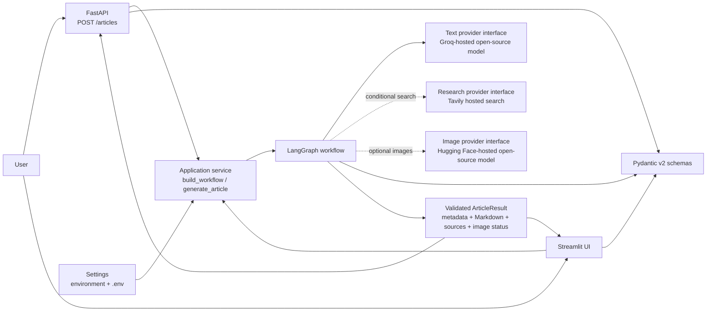
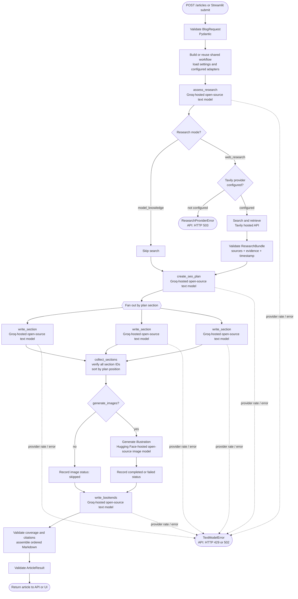

# SEO Blog Writing Assistant: Pipeline and Architecture

This document describes the implemented application: how a request enters the
system, how LangGraph routes it, where providers are called, how the article is
validated and assembled, and what the caller receives. The API and Streamlit
interface are separate entry points over the same application service and
workflow.

## Architecture at a glance



The dotted connections are conditional: Tavily is called only when the
workflow selects web research, and Hugging Face is called only when the request
sets `generate_images` to `true`. The text provider is required for article
generation.

The configured models are open-source/open-weight models accessed through
hosted provider APIs (Groq for text and Hugging Face for images), not models
downloaded and run locally by this application. The intended setup uses
provider free-tier quotas where available; quotas, access, and model
availability are controlled by each provider and can change. Tavily is a
hosted web-search service, not a model.

## End-to-end workflow



The section-writing nodes are dispatched concurrently by LangGraph. Their
completion order is not used as article order: each planned section has a
stable ID and position, and the collection and assembly steps check identity
and order against the original plan. The graph does not implement automatic
retry for provider failures.

## Pipeline stages

### 1. Request entry and validation

- The API exposes `POST /articles`; FastAPI parses and validates the JSON body
  as `BlogRequest`. Invalid input is rejected with HTTP 422 before generation.
- The Streamlit UI gathers the same request options, constructs the same
  `BlogRequest`, and displays validation errors in the page.
- `generate_article` is the shared application entry point. It invokes the
  compiled workflow with the request and validates the final output as an
  `ArticleResult`.
- Both entry points return or display the article result produced by the same
  workflow; UI and API do not maintain separate generation logic.

The request supports a topic, audience, tone, target country, target word
count, SEO goals, whether freshness or citations are required, and whether to
generate an image. Pydantic bounds these fields before the workflow uses them.

### 2. Configuration and provider construction

`Settings` loads configuration from environment variables and the project
`.env` file. Provider adapters are constructed when the application builds
the workflow:

| Purpose | Current adapter | Configuration |
| --- | --- | --- |
| Text generation | LangChain `ChatGroq` with structured JSON Schema output; the selected model is open source/open weight and runs through Groq's hosted inference | `SEO_BLOG_TEXT_MODEL_PROVIDER=groq`, `SEO_BLOG_TEXT_MODEL_NAME`, and `SEO_BLOG_GROQ_API_KEY` (or an accepted key alias) |
| Web research | Tavily hosted search and retrieved Markdown content; this is a search service, not a model | `SEO_BLOG_SEARCH_PROVIDER=tavily`, `SEO_BLOG_SEARCH_API_KEY` |
| Image generation | Open-source/open-weight image model through Hugging Face hosted inference; for example, Qwen-Image when available to the account | `SEO_BLOG_IMAGE_PROVIDER=huggingface`, `SEO_BLOG_IMAGE_MODEL_NAME`, `SEO_BLOG_HUGGINGFACE_TOKEN` |

This deployment uses hosted APIs rather than local inference. Use the
providers' free tiers where available, and check their current terms, quotas,
and model availability; free access is not guaranteed by the application.
Groq completions are limited to 2,048 tokens per call to reduce oversized
requests. This output cap cannot prevent 429 responses when the account's
organization-level token or request quota is exhausted.

Research and image generation are optional capabilities; text generation is
required. Provider interfaces allow the graph and application to be tested
with fakes rather than live network calls. Credentials are kept in secret
settings and should not be logged or committed.

### 3. Research decision and routing

The first graph node asks the text model for a validated `ResearchDecision`
using the topic and relevant request preferences. This is a decision about
whether general model knowledge is likely sufficient; it does not mean that
the topic has been searched or fact-checked.

- If freshness or citations are explicitly required, the workflow enforces
  the `web_research` route even if the model suggested `model_knowledge`.
- Otherwise, the model's validated choice selects the route.
- If web research is selected but no search provider is configured, the
  workflow reports a research-provider error instead of pretending research
  occurred.

### 4. Optional web search and evidence

On the research branch, the Tavily adapter builds a query from the topic and,
when present, the target country. It sends an authenticated hosted search
request asking for Markdown content. It validates returned metadata and
content, assigns stable source IDs, records a timestamp, and returns a
`ResearchBundle`.

The bundle preserves the original search evidence and source metadata in
workflow state. If the search request fails, its response is invalid, or it
returns no usable evidence, research fails explicitly; a completed research
bundle is never fabricated.

Before research is included in text-model prompts, the workflow compacts it to
at most three evidence snippets of up to 1,000 characters each, with metadata
for the cited sources. This prompt-size bound does not discard the full bundle
from workflow state.

### 5. SEO plan

The planning node asks the text model for an `SEOPlan`, containing article
metadata, a primary and related keywords, search intent, introduction and
conclusion briefs and budgets, and an ordered list of section briefs. Each
planned section includes an ID, position, heading, purpose, key points,
subheadings, and word budget.

Pydantic validates the plan, including unique section IDs, contiguous
zero-based positions in outline order, and a total word budget close to the
requested target. The order returned in the section list is authoritative;
positions are normalized to that order.

If research mode was selected, planning requires the completed research bundle.
Model-generated planning briefs are instructions for later writing, not
finished article paragraphs.

### 6. Concurrent section writing

LangGraph creates one `write_section` task for every planned section. Each
task receives the same request, plan, and research bundle, plus its own planned
section. The text provider returns a structured `SectionDraft`.

Each draft is validated for required content and coverage of the planned key
points. Its identity (section ID, position, and heading) is tied back to the
planned section rather than trusting model-echoed identity fields. Subheadings
must match the plan. Citations, if present, must refer to source IDs in the
research bundle.

The collector verifies that exactly one draft exists for every planned
section, rejects duplicate or unexpected IDs, and restores outline order by
position. Thus parallel completion timing cannot reorder the final article.

### 7. Optional image branch

After section drafts are collected, the graph checks `generate_images`:

- If false, it records an image result with status `skipped` and makes no image
  provider call.
- If true, it calls the separate Hugging Face image adapter with an editorial
  illustration prompt based on the topic and title.
- A successful result is validated as a PNG with bounded dimensions and size.
- An image-provider failure records status `failed`; it does not discard the
  written article.

Image configuration or provider access is needed only for requests that use
image generation. The image is returned in the article result as validated
Base64 data; the application does not write it to disk.

### 8. Bookends, validation, and Markdown assembly

The assembly node asks the text provider to write the finished introduction
and conclusion from their briefs. It then validates that:

- Every planned section has exactly one draft, with the expected identity and
  subheadings.
- Required key points are covered.
- Draft source IDs belong to the completed research bundle.
- Inline citations do not introduce undeclared source IDs.

Markdown is assembled deterministically in this order: title, introduction,
planned sections and their subheadings, conclusion, and (if cited) sources.
Source references are mapped to source metadata and URLs from the research
bundle. The final `ArticleResult` validates its metadata and citation/source
consistency.

The application returns this result to FastAPI or Streamlit. Articles and
images are not automatically saved to disk, and existing prototype files are
not overwritten.

## Failure behavior

| Failure | API behavior |
| --- | --- |
| Invalid request fields | HTTP 422 from request-schema validation |
| Missing required provider configuration | HTTP 503 |
| Required web research fails or is unavailable | HTTP 503 |
| Groq token or rate limit is exceeded | HTTP 429 with a sanitized detail |
| Other Groq or invalid structured-output failure | HTTP 502 with a sanitized detail |
| Optional image generation fails | Article is still returned; `image_result.status` is `failed` |
| Article integrity checks fail | The workflow fails rather than returning a success-shaped incomplete article |

Provider error details may intentionally be sanitized; check the provider's
dashboard for the exact rate-limit category and reset information. Free-tier
limits can be reached even when using open-source models. A single
article invokes the text model multiple times, and section-writing calls run in
parallel, so concurrent article requests can consume provider limits quickly.

## Source layout

```text
src/seo_blog_assistant/
|-- api.py                    FastAPI entry point and HTTP error mapping
|-- application.py            Shared workflow construction and invocation
|-- config.py                 Environment-backed Pydantic settings
|-- schemas.py                Request, workflow, provider, and result contracts
|-- ui.py                     Streamlit entry point
|-- providers/
|   |-- text_model.py         Structured text-model interface and adapter
|   |-- search.py             Research interface and Tavily implementation
|   `-- image.py              Image interface and Hugging Face implementation
`-- workflow/
    |-- graph.py              LangGraph nodes, routing, and fan-out
    |-- state.py              Typed graph state and section-draft reducer
    |-- research.py           Research decision and routing rules
    |-- research_context.py   Bounded evidence included in prompts
    |-- planning.py           SEO-plan prompt and validation
    |-- writing.py            Planned section writing and checks
    `-- assembly.py           Bookends, article validation, Markdown assembly
```

Automated tests live under `tests/`. They use deterministic fakes and mocked
provider responses, so the ordinary test suite does not require API keys or
network access.
